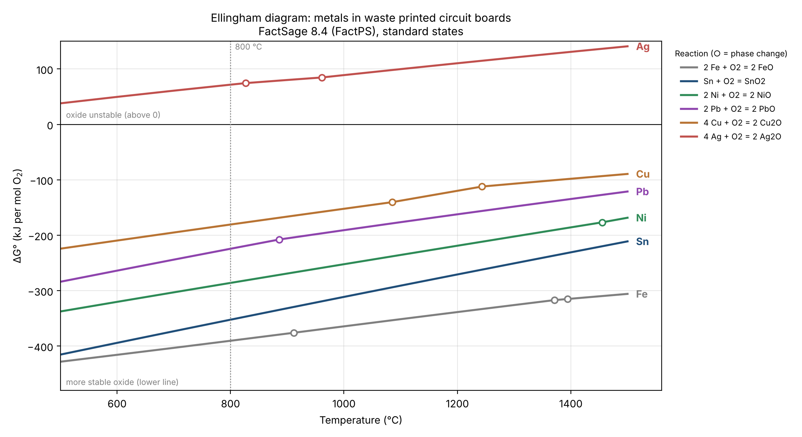

# Ellingham Diagram for Metals in Waste Printed Circuit Boards

Which metals in electronic scrap oxidise first, and which stay metallic? This repository answers that with thermodynamic data I calculated in **FactSage** and plotted in **Python**.



## Why this matters for recycling

Waste printed circuit boards (WPCB) contain copper and precious metals mixed with iron, tin, nickel and lead. In pyrometallurgical and molten-salt recycling routes, the **oxygen potential** decides which metals go into the slag or salt as oxides and which stay in the metal phase. An Ellingham diagram shows this at a glance:

- **Lower line:** the oxide is more stable, so the metal oxidises more easily.
- **Line above zero:** the oxide is not stable, so the metal stays metallic.

## Method

| | |
|---|---|
| **Software** | FactSage Education 8.4, *Reaction* module |
| **Database** | FactPS (pure substances) |
| **Reactions** | all written per **1 mol O₂**, so the lines are directly comparable |
| **Temperature** | 500 to 1500 °C, steps of 100 °C, plus every phase change FactSage reported |
| **Phases** | "most stable" (FactSage picks solid or liquid automatically) |
| **Analysis** | Python (pandas, NumPy, Matplotlib) |

Reactions calculated:

```
2 Fe + O2 = 2 FeO      Sn + O2 = SnO2       2 Ni + O2 = 2 NiO
2 Pb + O2 = 2 PbO      4 Cu + O2 = 2 Cu2O   4 Ag + O2 = 2 Ag2O
```

## Results

Running `analysis/plot_ellingham.py` gives the stability ranking at 800 °C:

| Rank | Metal | ΔG° (kJ/mol O₂) | log₁₀ p(O₂) at equilibrium (atm) |
|---|---|---|---|
| 1 | Fe | −390.3 | −19.0 |
| 2 | Sn | −352.3 | −17.1 |
| 3 | Ni | −286.0 | −13.9 |
| 4 | Pb | −224.3 | −10.9 |
| 5 | Cu | −180.6 | −8.8 |
| 6 | Ag | **+71.7** | +3.5 |

**What this shows:**

- **Fe, Sn, Ni and Pb all lie below Cu.** With a controlled oxygen potential, they can be oxidised into the slag or salt while copper stays metallic.
- **Ag lies above zero.** Silver oxide is not stable at process temperatures, so silver stays in the metal phase. Liquid copper acts as a collector for Ag, Au and Pd.
- **All oxides become less stable as temperature rises** (the lines slope upwards).
- **Sn has the steepest line.** At 500 °C tin and iron are almost equally stable as oxides; at 1500 °C tin's oxide is clearly less stable. Rankings can change with temperature, which is why the full diagram matters.
- **Equilibrium oxygen pressure:** to keep nickel metallic at 800 °C you need about 100 000 times less oxygen than for copper (10⁻¹³·⁹ vs. 10⁻⁸·⁸ atm).

**Phase changes** (open circles in the plot) appear as small kinks: Cu melts at 1084.85 °C, Cu₂O at 1243.55 °C, Ni at 1455.10 °C, PbO at 885.85 °C, Ag at 960.80 °C; FeO melts at 1371 °C, and iron changes its crystal structure at 911.66 and 1394.32 °C.

## Limitations

- **Standard states.** FactPS describes pure substances at 1 atm. In real melts the metals are dissolved in copper alloys, slags or salts, where their activities are below 1. Quantitative predictions need solution databases (FTsalt, FToxid) in the *Equilib* module.
- **Thermodynamics, not kinetics.** ΔG says whether a reaction can happen, not how fast.
- **Ag₂O at high temperature.** Ag₂O decomposes far below 500 °C; the values above that come from extrapolated database data and are only meaningful as "strongly unstable".
- **FeO below about 570 °C** is not the stable iron oxide; values below 600 °C should be read with care.

## Repository structure

```
├── data/
│   └── dG_oxidation_FactPS.csv   # ΔG° per mol O2 from FactSage (FactPS)
├── analysis/
│   └── plot_ellingham.py         # diagram, p(O2) conversion, ranking table
└── figures/
    └── ellingham_diagram.png
```

## Reproduce

```bash
pip install -r requirements.txt
python analysis/plot_ellingham.py
```

Change `PROCESS_T_C` at the top of the script to get the ranking at another temperature (any value in the data, e.g. 1000).

## Context

Part of my preparation alongside my Master's thesis on recycling waste printed circuit boards with molten salts (M.Sc. Materials Engineering, RWTH Aachen University).

**Author:** Midhun Jayaprakash

## License

MIT (see `LICENSE`). Thermodynamic values calculated with FactSage Education 8.4 (FactPS database, © Thermfact/CRCT and GTT-Technologies).
