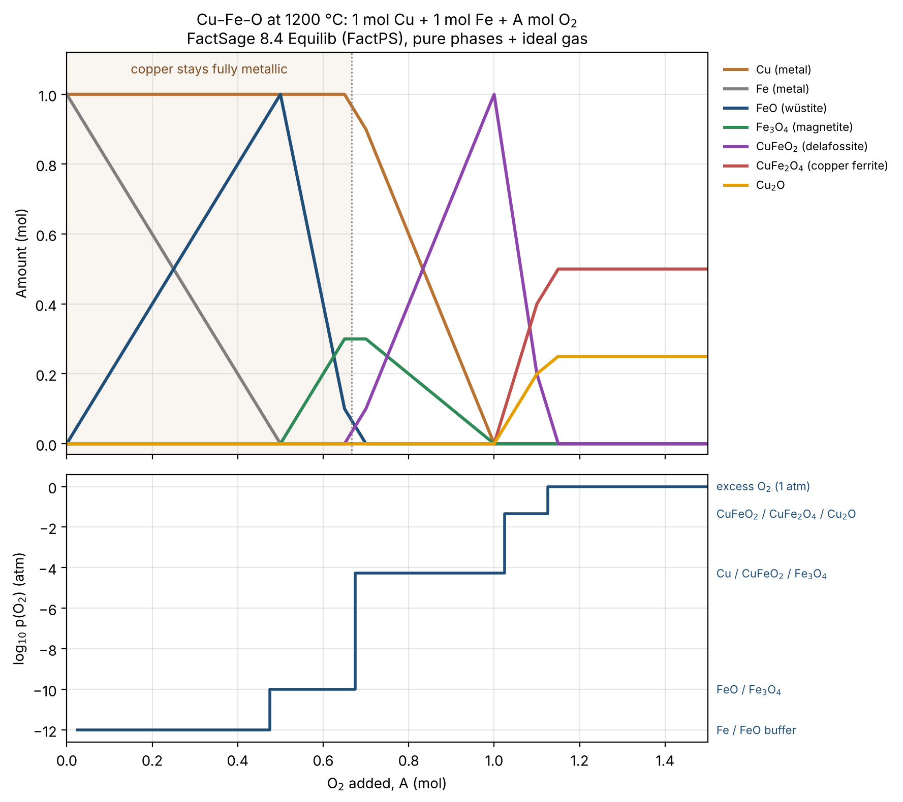

# Part 2: Cu–Fe–O equilibrium at 1200 °C (FactSage Equilib)

The Ellingham diagram in Part 1 compares each metal **on its own**. In a real smelter, copper and iron sit in the **same melt**, and mixed oxides can form. This part checks the Ellingham prediction with a full equilibrium calculation.

**Question:** If oxygen is added step by step to a copper–iron mixture at 1200 °C, which metal oxidises first, and when does copper start to be lost to the oxide phase?

## Setup

| | |
|---|---|
| Software | FactSage 8.4 (Education), Equilib module |
| Database | FactPS (pure substances) |
| Reactants | 1 mol Cu + 1 mol Fe + A mol O₂ |
| Oxygen steps | A = 0 to 1.5 mol, step 0.05 (31 calculations) |
| Conditions | 1200 °C, 1 atm |
| Products | ideal gas, pure liquids, pure solids (no solution phases) |

## Result



| O₂ added (mol) | What happens | log₁₀ p(O₂) (atm) |
|---|---|---|
| 0 → 0.5 | Fe → FeO (wüstite), copper untouched | −12.0 |
| 0.5 → 0.67 | FeO → Fe₃O₄ (magnetite), copper still untouched | −10.0 |
| 0.67 → 1.0 | Copper oxidises into CuFeO₂ (delafossite) | −4.3 |
| 1.0 → 1.125 | CuFeO₂ → CuFe₂O₄ (copper ferrite) + Cu₂O | −1.3 |
| > 1.125 | Fully oxidised, extra O₂ stays as gas | 0 |

**Key findings**

1. **Iron oxidises first, copper last**, as predicted by the Ellingham diagram (Part 1).
2. **Copper stays fully metallic until all the iron is oxidised to magnetite** (A ≈ 0.67 mol O₂). This is the operating window for removing iron into the slag while keeping copper in the metal.
3. Copper is then lost as the **mixed oxide CuFeO₂, not as Cu₂O**. A single-metal Ellingham diagram cannot show this; an equilibrium calculation can.
4. The oxygen pressure rises in **steps**. On each plateau, the same three phases coexist and buffer p(O₂). The first plateau (10⁻¹² atm) matches the Fe/FeO value from the Ellingham data in Part 1.

## Mass balance check

For every step, the script sums Cu, Fe and O over all phases and checks that Cu = 1 mol and Fe = 1 mol. Largest error: 1 × 10⁻¹⁶ mol.

## Files

| File | Content |
|---|---|
| `Equilib.txt` | Raw FactSage Equilib output (all 31 pages) |
| `plot_equilib_CuFeO.py` | Reads the raw output, checks the mass balance, makes the figure and the CSV |
| `CuFeO_1200C_equilib.csv` | Extracted phase amounts (mol) and log₁₀ p(O₂) for every step |
| `CuFeO_1200C_equilib.png` | Figure |

## Run it

```bash
pip install pandas matplotlib numpy
python plot_equilib_CuFeO.py Equilib.txt
```

## Limitations

- Pure phases only (FactPS). In a real smelter, copper and oxides dissolve into a liquid slag and matte (solution databases such as FToxid / FTmisc), which would shift the boundaries.
- Education licence: limited to 3 elements, so Sn, Ni, Pb and Ag from circuit boards are not included here.
- Equilibrium only: no kinetics.
